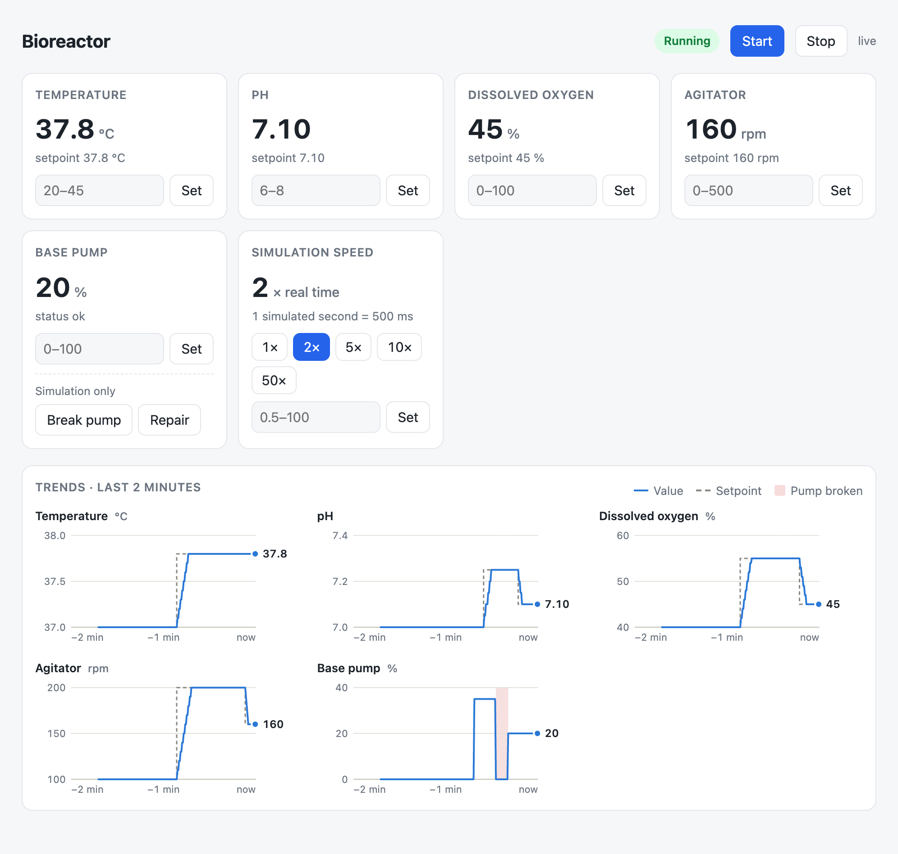
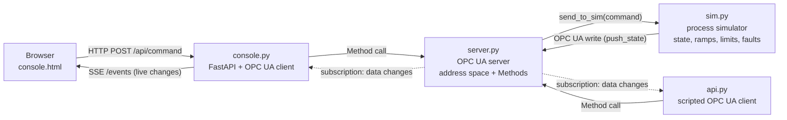
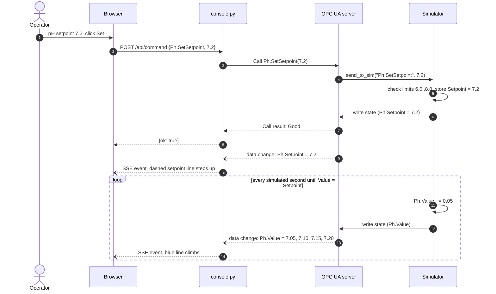
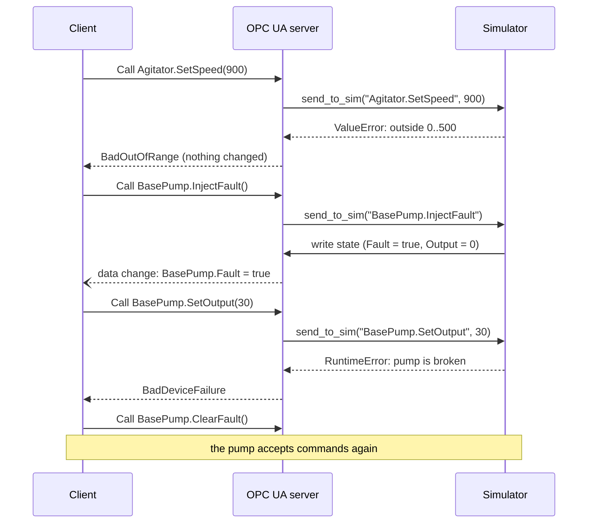
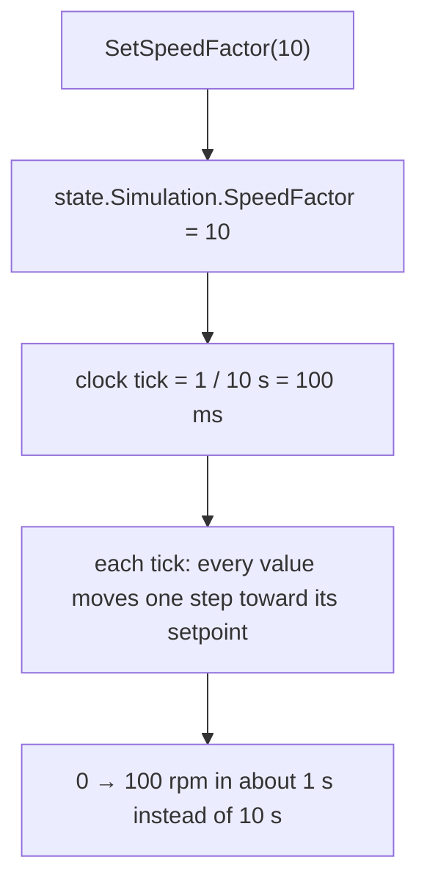
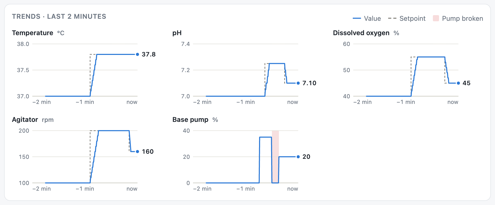

# Bioreactor OPC UA Simulator

A simulated bioreactor control system built on **OPC UA**: an industrial-style
server with a typed address space and Methods, a process simulator with ramps,
limits and fault injection, and a live **web console** that streams every change
from the plant to the browser.

<picture>
  <source media="(prefers-color-scheme: dark)" srcset="docs/console-dark.png">
  
</picture>

## Highlights

- **OPC UA server** (`asyncua`) exposing a bioreactor as a structured address space:
  sensors, actuators, setpoints and typed Methods.
- **Command → simulator → server** loop that mirrors a real PLC integration:
  clients never write process values directly; they call Methods, and the
  simulator publishes the resulting state.
- **Realistic process behaviour:** values ramp toward their setpoints at a fixed
  rate per simulated second, instead of jumping.
- **Fault injection with proper status codes:** out-of-range commands return
  `BadOutOfRange`; a broken pump returns `BadDeviceFailure`, and the failure is
  visible to every subscriber.
- **Time dilation:** run the process at 0.5×–100× real time, live from the console.
- **Web console** (FastAPI + Server-Sent Events): live values, commands, a
  2-minute trend for every measurement, a synced crosshair, light and dark mode.

## Architecture



| Component | Role |
|---|---|
| [`server.py`](server.py) | OPC UA server at `opc.tcp://localhost:4840/bioreactor/`. Builds the address space, exposes Methods, and translates simulator errors into OPC UA status codes. Starts the simulator's clock. |
| [`sim.py`](sim.py) | The plant. Holds the process state, validates commands against limits, ramps values toward setpoints on a clock, simulates device faults, and publishes its state back to the server through its own OPC UA client. |
| [`console.py`](console.py) + [`console.html`](console.html) | Operator console. One long-lived OPC UA client with a subscription; commands arrive over HTTP, changes leave over Server-Sent Events. |
| [`api.py`](api.py) | Scripted client: wraps each Method in a small function, subscribes to changes, and runs a scenario. Useful for automated checks. |

The simulator knows nothing about OPC UA status codes and the server knows
nothing about how the simulator stores or publishes state. The single seam
between them, `send_to_sim()`, is where an HTTP call to a separately deployed
simulator would go.

## Address space

```
Objects
└── Bioreactor
    ├── State                 String    Idle | Running
    ├── Start()  Stop()
    ├── Temperature           Value, Setpoint (°C)        SetSetpoint(Double)
    ├── Ph                    Value, Setpoint             SetSetpoint(Double)
    ├── DissolvedOxygen       Value, Setpoint (% sat.)    SetSetpoint(Double)
    ├── Agitator              Speed, Setpoint (rpm)       SetSpeed(Double)
    ├── BasePump              Output (%), Fault (Bool)    SetOutput(Double)
    │                                                     InjectFault()  ClearFault()   ← simulation only
    └── Simulation            SpeedFactor                 SetSpeedFactor(Double)        ← simulation only
```

Namespace: `urn:opc-practice:bioreactor`. Clients find nodes by **browse path**
(`2:Bioreactor/2:Ph/2:Value`), never by auto-assigned numeric NodeIds.

| Measurement | Limits | Ramp rate (per simulated second) |
|---|---|---|
| Temperature | 20–45 °C | 0.1 °C |
| pH | 6.0–8.0 | 0.05 |
| Dissolved oxygen | 0–100 % | 2 % |
| Agitator | 0–500 rpm | 10 rpm |
| Base pump output | 0–100 % | instant |
| Simulation speed | 0.5–100× | — |

## Workflows

### Changing the pH setpoint

The operator asks for pH 7.2. The setpoint changes at once; the measured pH then
climbs toward it, one step per simulated second, and every step reaches the
browser through the subscription.



### A command the plant refuses

Validation lives in the simulator, which raises plain Python errors. The server
maps each kind of error to a specific OPC UA status code, so clients can react
differently to bad input and broken hardware.



### Time dilation

`Simulation.SpeedFactor` shortens the real duration of one simulated second
without changing the process: an agitator ramp from 0 to 100 rpm is ten steps
of 10 rpm at any speed.



Two limits apply at high speed: the simulator's per-tick write to the server,
and the subscription's publishing interval, which batches several steps into
one notification.

## Trend view



Each measurement gets its own chart because units differ (°C, pH, rpm) and must
not share an axis. Changes arrive only when a value moves, so the page samples
the latest values every 0.5 s (sample and hold): ramps draw as slopes,
setpoint changes as clean steps, and the pump failure as a labelled band.

## Running it

Tested with Python 3.14.

```bash
python3 -m venv .venv
source .venv/bin/activate
pip install -r requirements.txt
```

Start the OPC UA server (it also starts the simulator):

```bash
python server.py
```

In a second terminal, start the console and open http://localhost:8000:

```bash
uvicorn console:app --port 8000
```

Optional: run the scripted client scenario, or browse the server from the command line:

```bash
python api.py
```

```bash
uals -u opc.tcp://localhost:4840/bioreactor/ -p 0:Objects,2:Bioreactor -d 2 -l 1
```

Set `OPC_URL` to point the console at another server, for example
`OPC_URL=opc.tcp://otherhost:4840/bioreactor/ uvicorn console:app`.

## Design decisions

- **Methods for every change.** Process variables are owned by the plant; clients
  request changes through Methods (`SetSetpoint`, `SetSpeed`, `Start`). This gives
  validation with a reason, atomic multi-value updates, and a clear audit point,
  and it avoids the "who resets the command bit" problem of write-to-trigger tags.
- **The simulator publishes its own state.** After any change, and on every clock
  tick where something moved, the simulator writes its state back through an OPC
  UA client, the same way an external device service would.
- **Specific status codes.** Input errors and device failures map to
  `BadOutOfRange` and `BadDeviceFailure`. A handler *returns* the status code;
  raising inside an `asyncua` Method would always surface as `BadUnexpectedError`.
- **Subscriptions, not polling.** The server sends only real changes, batched per
  publishing interval, to every subscriber at once. The console turns those into
  Server-Sent Events, a one-way push that fits a dashboard better than a WebSocket.
- **Simulation controls are clearly separate.** `InjectFault`, `ClearFault` and
  `SetSpeedFactor` are marked simulation-only; on a real device they would live on
  the simulator's own control interface.

## Limitations and next steps

- Security is off (`SecurityPolicy None`, anonymous access). Next: certificates,
  `Basic256Sha256`, and per-user rights so only the simulator may write process values.
- The simulator runs in the server's process and is called directly. Next: run it as
  its own service behind HTTP, keeping `send_to_sim()` as the only change.
- `push_state()` opens a new connection per update; a long-lived client would cut
  latency and raise the usable speed factor.
- Values ramp linearly; a PID loop would add realistic overshoot and settling.
- Trends live in the browser only; an OPC UA historian would keep them.

## Tech stack

Python 3.14 · [asyncua](https://github.com/FreeOpcUa/opcua-asyncio) 2.1 ·
FastAPI 0.162 · Uvicorn 0.54 · vanilla JavaScript + SVG (no front-end build step)
